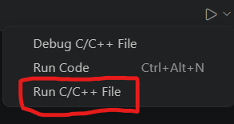

# Stone Paper Scissors Game-C++ 

---
## Problem Statement :
```text

- اسأل عن عدد جولات اللعبة.
- ابدأ كل جولة: لاعب ضد كمبيوتر.
- اعرض نتائج كل جولة.
- إذا فاز الكمبيوتر بالجولة، ستظهر نتيجة الجولة مع صوت جرس  وشاشة حمراء.
- إذا فاز اللاعب بالجولة، ستظهر شاشة خضراء.
- بعد انتهاء جميع الجولات، اعرض "انتهت اللعبة"، واطبع نتائج اللعبة، ثم اسأل المستخدم عما إذا كان يريد اللعب مرة أخرى؟

```
---

## Project Description : 
    مشروع تدريبي لتطبيق أساسيات لغة C++ من خلال بناء لعبة كاملة بدلا من حل مسائل منفصلة 
---

## السمات : 
```text
- لعبة بين المستخدم(اللاعب) والكمبيوتر
- اللاعب يختار عدد الجولات 
- تبدأ الجولة 
- يختار الاعب حجرة او ورقة او مقص
- يختار الكمبيوتر عشوائيا 
- تحديد نتيجة كل جولة بناء على اختيار اللاعب و الكمبيوتر
- في حالة ربح الاعب يعطي للشاشة لون اخضر 
- في حال ربح الكمبيوتر يعطي صوت جرس ولون احمر للشاشة
- في حالة التعادل يعطي لون اصفر للشاشة
- ثم يعرض البرنامج التنيجة نهائيا لكل اللعبة ويعطي احصائية اللعبة كلها ويحدد فوز بحسب عدد مرات فوز في كل جولة 
- يعطي ايضا لون للشاشة مثل نتيجة الجولات
```
---

## الادوات واللغات المستخدمة : 
```text
- C++
- دوال تم تجهيزها سابقا من مشاكل ال (50) التي تم حلها
```
---

## طريقة التشغيل :
- قم بتنزيل المشروع من المستودع بالامر التالي : 
    git clone https://github.com/Moh-Almousa/Stone-Paper-Scissors-game
- افتح ملف Stone-Paper-Scissors-game.cpp في فيجوال كود ستوديو او فيجول ستوديو
- في حالة vs code انت بحاجة لتنزيل كومبيلر اللغة c++ سارفق لك موقع يشرح كيفية اضافة وتشغيل اللغة في vs code :
   [دليل اعداد C++ في VS Code](https://code.visualstudio.com/docs/cpp/config-msvc)
- تقوم بتنفيذ الملف حسب المحرر الذي تستخدمه انا استخدم vs code مع اضافة c++ وفق الخطوات المرفقة في الموقع السابق عن طريق الامر التالي :


---

## كيف تلعب اللعبة ؟

1. اولا تختار عدد الجولات بين 0 لل 10
2. تختار رقم 1:يمثل الحجرة 2: يمثل الورقة 3: يمثل المقص
3. سيختار الكمبيوتر لوحده 
4. تظهر امامك قائمة الجولة وتتغير لون الشاشة كتالي
   - لون اخضر اذا انت فزت
   -  لون احمر مع صوت جرس اذا انت خسرت 
   - لون اصفر اذا تعادلت انت والكمبيوتر
5. تكرر الخطوة رقم 2 الى انت تنتهي الجولات
6. عن الانتهاء تظهر امامك نتيجة النهائية للعبة فيها تفاصيل كل جولات وهي :
   -  عدد الجولات 
   -  عدد مرات فوزك
   -  عدد مرات فوز الكمبيوتر
   -  عدد مرات التعادل
   -  اسم الفائز اللاخير انت(Player1) او الكمبيوتر  وتتغير لون شاشة مثل كل جولة
7. يعرض لك سؤال هل مازلت تريد اللعب اذا نعم اختار (Y) اذا  انتهيت اختار (N) 
8. اذا نعم ستعاد اللعبة من جديد ويتم مسح شاشة واعادة لونها الافتراضي وتعود للخطوة رقم 1
9. 
---

## الهدف من المشروع :
```text
- تعلم تقسم مشروع كامل لدوال 
- طريقة استدعاء وربط الدوال
- نظرية فرق تسد وهي تقسيم المشروع لمهام صغيرة 
- تطبيق كل ماتم تعلمه من المشاكل البرمجية السابقة لان حل مشكلة لايغني عن تطبيقها في مشروع كامل متكامل
```
---

# 👨‍💻 المطور

**Moh-Almousa** : Mohammad Almousa

Software Engineering Student

---